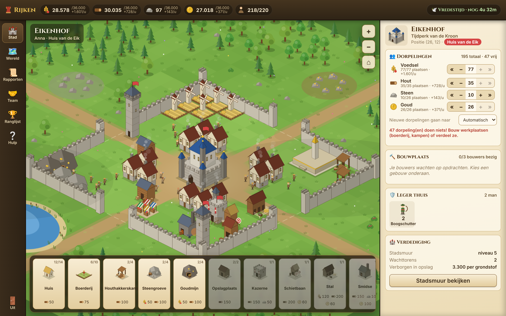
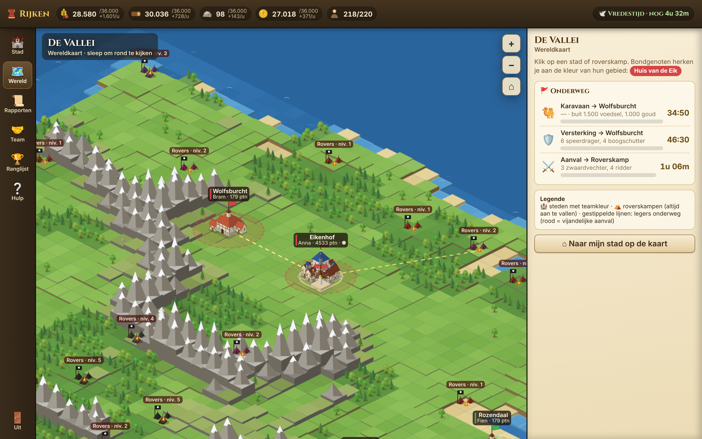

# ♜ Rijken van de Vallei

Een browser-strategiespel in de stijl van klassieke "bouw je rijk"-games, gemaakt om met een kleine groep vrienden
te spelen over **vier weken**:

- **3 weken vredestijd** — iedereen bouwt zijn economie op, traint troepen en verslaat roverskampen.
  Spelers kunnen elkaar nog niet aanvallen.
- **1 week oorlog** — nu mag je vijandelijke steden aanvallen, verkennen en plunderen.
- **Automatische bondgenoten** — wie zich inschrijft, wordt automatisch aan een team gekoppeld
  (standaard teams van 2). Bondgenoten starten naast elkaar, kunnen elkaar niet aanvallen,
  maar wel troepen en grondstoffen sturen en chatten.

Het spel draait volledig op het **gratis plan van Cloudflare Pages + D1** — er is geen server die altijd moet draaien.




## Wat zit erin?

- **Isometrische, getekende wereld** (geen tekstspel): je eigen stad met wandelende dorpelingen, rook uit de
  schoorstenen, wapperende vlaggen, troepen die bij de kazerne staan, een palissade die een stenen muur wordt…
  Alles wordt procedureel getekend met Canvas — er zijn geen afbeeldingsbestanden nodig.
- **Wereldkaart** met heuvels, bergen, bossen, meren en kust, de gebieden van elk team in hun kleur,
  roverskampen met kampvuren, en legers die zichtbaar over de kaart marcheren.
- **Economie**: voedsel, hout, steen en goud. Dorpelingen werken op werkplekken (boerderijen, kampen, mijnen).
  Opslag, bevolking (huizen) en 4 tijdperken.
- **14 gebouwen** met elk meerdere niveaus, **7 soorten troepen** (speerdrager, zwaardvechter, boogschutter,
  verkenner, ruiter, ridder, stormram) met sterktes en zwaktes.
- **Gevechten** met muren, torens, smidse-bonussen, plunderen, verkennen, rammen die muren en monumenten slopen.
- **Samenwerken**: versterking sturen naar je bondgenoot, karavanen met grondstoffen, teamchat en wereldchat.
- **Rapporten**, **ranglijst** (team- en spelerspunten) en een **eindstand** na de oorlog.
- Werkt op **desktop en gsm**.
- **Spelleiderspagina** (`/admin.html`) om een seizoen te starten, te verplaatsen of berichten te sturen.

## Online zetten (gratis, ±10 minuten)

Je hebt nodig: een gratis [Cloudflare-account](https://dash.cloudflare.com/sign-up) en [Node.js](https://nodejs.org) 18 of nieuwer.

```bash
npm install
npx wrangler login

# 1. maak de database aan en kopieer de "database_id" naar wrangler.toml
npx wrangler d1 create rijken-db

# 2. maak de tabellen aan
npm run db:init:remote

# 3. maak het Pages-project en zet het spel online
npx wrangler pages project create rijken-van-de-vallei --production-branch main
npm run deploy

# 4. kies een geheime beheerderssleutel
npx wrangler pages secret put ADMIN_KEY --project-name rijken-van-de-vallei
npm run deploy   # opnieuw, zodat de sleutel actief wordt
```

Open daarna `https://rijken-van-de-vallei.pages.dev/admin.html`, vul je `ADMIN_KEY` in en klik op
**Wereld (opnieuw) aanmaken**. Kies daar:

| Instelling | Standaard | Uitleg |
|---|---|---|
| Startmoment | nu | Vóór de start kunnen spelers zich al inschrijven ("lobby"). |
| Vredestijd | 21 dagen | Geen aanvallen tussen spelers. |
| Oorlog | 7 dagen | Daarna is het seizoen voorbij en ligt de eindstand vast. |
| Spelsnelheid | 1 | Hoger = alles (bouwen, productie, marsen) gaat sneller. Handig om te testen. |
| Spelers per team | 2 | Bepaalt hoeveel bondgenoten er automatisch gekoppeld worden. |
| Deelnamecode | — | Optioneel: enkel wie de code kent, kan zich inschrijven. |

Deel daarna de link (en de code) met je vrienden. 🎉

> **Liever via GitHub?** In het Cloudflare-dashboard: *Workers & Pages → Create → Pages → Connect to Git*,
> kies deze repository, laat het build-commando leeg en zet de output-map op `public`.
> De D1-koppeling komt uit `wrangler.toml`; de `ADMIN_KEY` stel je in bij *Settings → Variables and Secrets*.

## Lokaal spelen en testen

```bash
npm install
cp .dev.vars.example .dev.vars        # bevat ADMIN_KEY=verander-mij
npm run db:init:local
npm run dev                           # http://localhost:8788
npm test                              # spelregels testen
```

Ga naar `http://localhost:8788/admin.html`, maak een wereld met bv. **snelheid 100** en **0,05 dagen vrede**,
en registreer een paar spelers in verschillende browservensters (of privévensters) om het samenspel te testen.

## Binnen de gratis limieten blijven

Het spel is gebouwd rond de limieten van het gratis plan:

| Limiet (gratis) | Hoe het spel ermee omgaat |
|---|---|
| Workers: 100.000 verzoeken/dag | De browser vraagt de status maar elke 20 s op (en niet als het tabblad verborgen is). Timers en grondstoffen tellen lokaal door. 10 spelers die elk 4 uur per dag spelen ≈ 7.000 verzoeken. |
| Workers: 10 ms CPU per verzoek | Lichte berekeningen; wachtwoorden met een bewust beperkt aantal PBKDF2-rondes. Het terrein wordt in de browser gegenereerd, niet op de server. |
| D1: 5 miljoen gelezen rijen/dag | Elke stad is één rij (JSON). Een statusverzoek leest ±10–20 rijen dankzij indexen. |
| D1: 100.000 geschreven rijen/dag | Er wordt enkel geschreven bij acties (bouwen, trainen, …) en hoogstens één keer per minuut "laatst gezien". |
| D1: 50 query's per verzoek | Het verwerken van aangekomen legers stopt na ±30 query's; de rest gebeurt bij het volgende verzoek. |
| Geen achtergrondtaken nodig | Productie, bouwen en gevechten worden **"lui" berekend**: pas wanneer iemand de site bezoekt, wordt alles tot op dat moment bijgewerkt — in de juiste volgorde. Ook als niemand online is, loopt het spel dus gewoon verder. |

Oude rapporten (> 14 dagen) en chatberichten (> 300 per kanaal) worden automatisch opgeruimd.

## Spelregels aanpassen

Alle cijfers (kosten, bouwtijden, productie, troepen, kampen…) staan op één plek:
[`public/shared/rules.js`](public/shared/rules.js). Die code wordt zowel door de server als door de browser gebruikt,
dus een aanpassing geldt meteen overal. Voer daarna `npm test` uit.

Indicatie bij snelheid 1 voor een zeer actieve speler die enkel op economie speelt: tijdperk 2 na ±1,5 dag,
tijdperk 3 na ±3,5 dagen, tijdperk 4 na ±7,5 dagen, en een volledig monument rond dag 14.
Wie ook een leger opbouwt of minder vaak inlogt, doet er langer over — dat past bij drie weken vrede.

## Hoe zit het in elkaar?

```
public/                 statische website (Cloudflare Pages)
  index.html, css/      interface
  js/main.js            spelverloop in de browser, knoppen, peilen
  js/town.js            isometrische stad (canvas)
  js/world.js           wereldkaart (canvas)
  js/art.js             procedurele tekeningen: gebouwen, mensen, bomen…
  js/ui.js              panelen en vensters
  shared/rules.js       ALLE spelregels en balans
  shared/sim.js         simulatie van een stad (gedeeld met de server)
  shared/battle.js      gevechtsformules
  shared/worldgen.js    terreingenerator (seed → kaart)
  admin.html            spelleiderspagina
functions/api/[[path]].js   alle /api-routes (Pages Functions)
functions/lib/          sessies, database, verwerking van legers en gevechten
schema.sql              D1-databaseschema
tests/                  tests voor de spelregels (node --test)
```

Veiligheid: wachtwoorden worden gehasht (PBKDF2 met zout), sessies zitten in een HttpOnly-cookie,
alle acties worden op de server opnieuw gecontroleerd (de browser kan niet valsspelen met grondstoffen of troepen),
en gelijktijdige wijzigingen worden opgevangen met versienummers.
