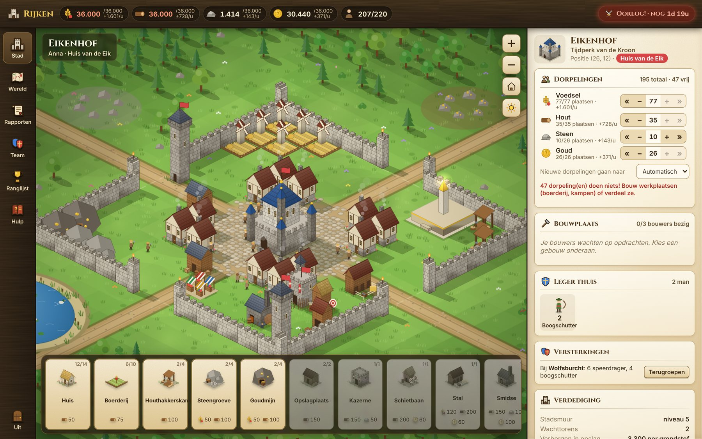
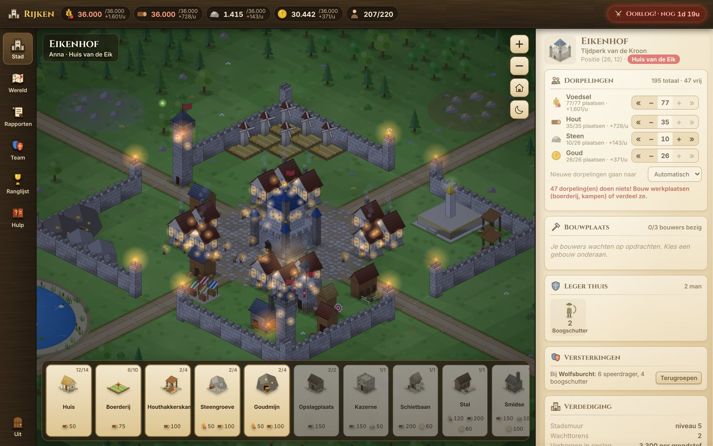
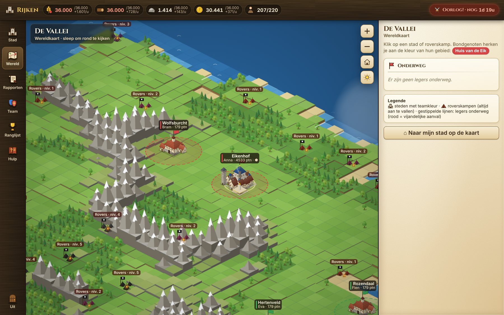

# ♜ Rijken van de Vallei

Een browser-strategiespel in de stijl van klassieke "bouw je rijk"-games, gemaakt om met een kleine groep vrienden
te spelen over **vier weken**:

- **3 weken vredestijd** — iedereen bouwt zijn economie op, traint troepen en verslaat roverskampen.
  Spelers kunnen elkaar nog niet aanvallen.
- **1 week oorlog** — nu mag je vijandelijke steden aanvallen, verkennen en plunderen.
- **Automatische bondgenoten** — wie zich inschrijft, wordt automatisch aan een team gekoppeld
  (standaard teams van 2). Bondgenoten starten naast elkaar, kunnen elkaar niet aanvallen,
  maar wel troepen en grondstoffen sturen en chatten.

Het spel draait volledig op het **gratis plan van Cloudflare Pages + D1** — er is geen server die altijd moet draaien.





## Wat zit erin?

- **Isometrische, getekende wereld** (geen tekstspel): je eigen stad met wandelende dorpelingen, rook uit de
  schoorstenen, wapperende vlaggen, troepen die bij de kazerne staan, een palissade die een stenen muur wordt,
  kasseien, slagschaduwen, een vijver met eendjes, schapen, vlinders en vogels.
- **Dag en nacht** volgens je klok: 's avonds gaan vensters en fakkels branden, 's nachts dansen er vuurvliegjes
  (met een knop ook altijd dag of altijd nacht).
- Feestelijke effecten als een gebouw klaar is, vuurwerk bij een nieuw tijdperk.
  Alles wordt procedureel getekend met Canvas — er zijn geen afbeeldingsbestanden nodig.
- **Wereldkaart** met heuvels, bergen, bossen, meren en kust, de gebieden van elk team in hun kleur,
  roverskampen met kampvuren, en legers die zichtbaar over de kaart marcheren.
- **Vondsten**: af en toe verschijnt er rond je stad een verdwaald schaap, een eik vol brandhout, rotsblokken of een goudader.
  Klik een dorpeling aan en dan de vondst: hij haalt de buit op en gaat daarna terug aan zijn werk.
- **Gevechten met levenspunten**: in je eigen gebied zie je elk gevecht mannetje per mannetje, met een levensbalk,
  slagen, pijlen en sneuvelende strijders. Barbaren vallen meteen aan wie hun dorp nadert.
- **Vijf volkeren** om uit te kiezen bij het stichten van je rijk: Egyptenaren, Grieken, Yamato, Babyloniërs en Perzen.
  Elk volk heeft een eigen bouwstijl (platte zandstenen daken en obelisken, marmeren zuilen, pagodes, blauwe ziggurat,
  turquoise koepels) en twee elite-eenheden met speciale eigenschappen, te trainen in het kasteel (stadscentrum vanaf het IJzertijdperk).
- **Eigen gebied met oorlogsmist**: rond je stad ligt wildernis die enkel van jou is. Tik op een dorpeling of soldaat
  en dan op de grond: hij loopt er in echte tijd naartoe en de mist verdwijnt. Kap bomen om je bouwgrond uit te breiden
  (die groeit ook mee met elk tijdperk), ontgin goudaders en rotswanden, jaag op everzwijnen en verwoest het
  barbarenkamp dat af en toe je stad overvalt.
- **Economie**: voedsel, hout, steen en goud. Dorpelingen werken op werkplekken (boerderijen, kampen, mijnen).
  Opslag, bevolking (huizen) en 4 tijdperken.
- **14 gebouwen** met elk meerdere niveaus, **7 soorten troepen** (speerdrager, zwaardvechter, boogschutter,
  verkenner, ruiter, ridder, stormram) met sterktes en zwaktes.
- **Gevechten** met muren, torens, smidse-bonussen, plunderen, verkennen, rammen die muren en monumenten slopen.
- **Meldingen op je gsm**: ±2 minuten voor je leger aankomt (of je stad aangevallen wordt) een melding, met in het spel
  een aftelling waarbij je al kan kiezen: zelf besturen of automatisch.
- **Android-app**: `public/rijken-van-de-vallei.apk` (te downloaden via de site) opent het spel volledig scherm.
  Opnieuw bouwen met `android/build-apk.sh`.
- **Troepen kiezen** zoals in Age of Empires: 1 klik = 1 troep, dubbelklik = alle troepen van die soort, ingedrukt
  houden = je hele leger (ook op gsm en op het slagveld).
- **Veldslagen zelf besturen**: komt je leger aan bij een stad of roverskamp terwijl je online bent, dan kies je tussen zelf besturen
  of automatisch (zoals in Rome: Total War). Zelf besturen opent een slagveld waar je troepen selecteert (dubbelklik = hele soort),
  verplaatst en doelwitten kiest. De verdediger krijgt een melding en kan zijn stad zelf verdedigen. Wachttorens schieten op de
  dichtstbijzijnde vijand en kunnen gesloopt worden; muren houden aanvallers tegen tot er een bres is.
- **Samenwerken**: versterking sturen naar je bondgenoot, karavanen met grondstoffen, teamchat en wereldchat.
- **Rapporten**, **ranglijst** (team- en spelerspunten) en een **eindstand** na de oorlog.
- Werkt op **desktop en gsm**.
- **Spelleiderspagina** (`/admin.html`) om een seizoen te starten, te verplaatsen of berichten te sturen.

## Automatisch online zetten (gratis, eenmalig ±10 minuten — kan op je gsm)

Elke wijziging die Claude (bv. vanuit de Claude-app op je gsm) naar een sessie-branch pusht, wordt automatisch:

1. **getest** (`npm test`),
2. **gecherry-pickt naar `main`** (`scripts/promote.sh`), en
3. **online gezet op Cloudflare** (`scripts/deploy.sh`) — inclusief database, migraties en het Pages-project.

Dat regelt de GitHub-actie [`.github/workflows/deploy.yml`](.github/workflows/deploy.yml). Je volgt het in het tabblad
**Actions** van de repository. Eenmalig in te stellen:

**1. Cloudflare-token maken** — op [dash.cloudflare.com](https://dash.cloudflare.com) (gratis account):
- *My Profile → API Tokens → Create Token → Create Custom Token*
- Rechten: **Account · Cloudflare Pages · Edit**, **Account · D1 · Edit** en **Account · Workers Scripts · Edit** → *Continue → Create Token* → kopieer het token.
  (Het laatste recht is voor de kleine worker die elke minuut de meldingen op je gsm verstuurt. Zonder dat recht werkt
  het spel gewoon, maar gaan meldingen enkel uit als iemand het spel open heeft.)
- Je **Account ID** vind je op de startpagina van het dashboard (rechts, of in de adresbalk na `dash.cloudflare.com/`).

**2. Geheimen in GitHub zetten** — in de repository: *Settings → Secrets and variables → Actions → New repository secret*:

| Naam | Waarde |
|---|---|
| `CLOUDFLARE_API_TOKEN` | het token van stap 1 |
| `CLOUDFLARE_ACCOUNT_ID` | je account-id |
| `ADMIN_KEY` | een zelfgekozen wachtwoord voor de spelleiderspagina |

**3. `main` als standaardbranch** — *Settings → General → Default branch* → kies **main**.
Zo starten nieuwe Claude-sessies altijd vanaf de nieuwste versie.

**4. Eerste keer starten** — *Actions → Testen en online zetten → Run workflow* (of laat Claude iets pushen).
Na ±2 minuten staat het spel op **https://rijken-van-de-vallei.pages.dev**.

**5. Seizoen aanmaken** — open `https://rijken-van-de-vallei.pages.dev/admin.html`, vul je `ADMIN_KEY` in en klik op
**Wereld (opnieuw) aanmaken**. Kies daar:

| Instelling | Standaard | Uitleg |
|---|---|---|
| Startmoment | nu | Vóór de start kunnen spelers zich al inschrijven ("lobby"). |
| Vredestijd | 21 dagen | Geen aanvallen tussen spelers. |
| Oorlog | 7 dagen | Daarna is het seizoen voorbij en ligt de eindstand vast. |
| Spelsnelheid | 1 | Hoger = alles (bouwen, productie, marsen) gaat sneller. Handig om te testen. |
| Spelers per team | 2 | Bepaalt hoeveel bondgenoten er automatisch gekoppeld worden. |
| Deelnamecode | — | Optioneel: enkel wie de code kent, kan zich inschrijven. |

Deel daarna de link (en de code) met je vrienden. 🎉

### Werken vanaf je gsm

Open de Claude-app → **Code** → kies deze repository en vraag wat je wil veranderen
("maak de kazerne mooier", "voeg een nieuw soort troep toe", …). Claude volgt de afspraken in
[`CLAUDE.md`](CLAUDE.md), test en pusht; de actie doet de rest. Mislukt de stap *Overnemen op main* door een conflict,
vraag Claude dan om "de branch bij te werken met main en opnieuw te pushen".

### Handmatig online zetten (optioneel)

```bash
npm install
npx wrangler login
ADMIN_KEY=kies-een-wachtwoord npm run deploy   # maakt database en project aan als ze nog niet bestaan
```

## Lokaal spelen en testen

```bash
npm install
cp .dev.vars.example .dev.vars        # bevat ADMIN_KEY=verander-mij
npm run db:init:local
npm run dev                           # http://localhost:8788
npm test                              # spelregels testen
```

Ga naar `http://localhost:8788/admin.html`, maak een wereld met bv. **snelheid 100** en **0,05 dagen vrede**,
en registreer een paar spelers in verschillende browservensters (of privévensters) om het samenspel te testen.

## Binnen de gratis limieten blijven

Het spel is gebouwd rond de limieten van het gratis plan:

| Limiet (gratis) | Hoe het spel ermee omgaat |
|---|---|
| Workers: 100.000 verzoeken/dag | De browser vraagt de status maar elke 20 s op (en niet als het tabblad verborgen is). Timers en grondstoffen tellen lokaal door. 10 spelers die elk 4 uur per dag spelen ≈ 7.000 verzoeken. |
| Workers: 10 ms CPU per verzoek | Lichte berekeningen; wachtwoorden met een bewust beperkt aantal PBKDF2-rondes. Het terrein wordt in de browser gegenereerd, niet op de server. |
| D1: 5 miljoen gelezen rijen/dag | Elke stad is één rij (JSON). Een statusverzoek leest ±10–20 rijen dankzij indexen. |
| D1: 100.000 geschreven rijen/dag | Er wordt enkel geschreven bij acties (bouwen, trainen, …) en hoogstens één keer per minuut "laatst gezien". |
| D1: 50 query's per verzoek | Het verwerken van aangekomen legers stopt na ±30 query's; de rest gebeurt bij het volgende verzoek. |
| Geen achtergrondtaken nodig | Productie, bouwen en gevechten worden **"lui" berekend**: pas wanneer iemand de site bezoekt, wordt alles tot op dat moment bijgewerkt — in de juiste volgorde. Ook als niemand online is, loopt het spel dus gewoon verder. |

Oude rapporten (> 14 dagen) en chatberichten (> 300 per kanaal) worden automatisch opgeruimd.

## Spelregels aanpassen

Alle cijfers (kosten, bouwtijden, productie, troepen, kampen…) staan op één plek:
[`public/shared/rules.js`](public/shared/rules.js). Die code wordt zowel door de server als door de browser gebruikt,
dus een aanpassing geldt meteen overal. Voer daarna `npm test` uit.

Indicatie bij snelheid 1 voor een zeer actieve speler die enkel op economie speelt: tijdperk 2 na ±1,5 dag,
tijdperk 3 na ±3,5 dagen, tijdperk 4 na ±7,5 dagen, en een volledig monument rond dag 14.
Wie ook een leger opbouwt of minder vaak inlogt, doet er langer over — dat past bij drie weken vrede.

## Hoe zit het in elkaar?

```
public/                 statische website (Cloudflare Pages)
  index.html, css/      interface
  js/main.js            spelverloop in de browser, knoppen, peilen
  js/town.js            isometrische stad (canvas)
  js/world.js           wereldkaart (canvas)
  js/art.js             procedurele tekeningen: gebouwen, mensen, bomen…
  js/fx.js              dag en nacht, licht, deeltjes, wolken, vogels
  js/icons.js           eigen SVG-iconen
  js/ui.js              panelen en vensters
  shared/rules.js       ALLE spelregels en balans
  shared/sim.js         simulatie van een stad (gedeeld met de server)
  shared/battle.js      gevechtsformules
  shared/worldgen.js    terreingenerator (seed → kaart)
  shared/territory.js   eigen gebied rond een stad: bomen, meren, bronnen, everzwijnen, kamp en mist
  admin.html            spelleiderspagina
functions/api/[[path]].js   alle /api-routes (Pages Functions)
functions/lib/          sessies, database, verwerking van legers en gevechten
migrations/             D1-databaseschema (nieuwe wijzigingen = nieuw bestand)
scripts/promote.sh      neemt commits van een Claude-branch over op main (cherry-pick)
scripts/deploy.sh       zet alles online op Cloudflare (database, migraties, publicatie)
.github/workflows/      de automatische test- en deploy-actie
CLAUDE.md               afspraken voor Claude-sessies (ook vanaf je gsm)
tests/                  tests voor de spelregels (node --test)
```

Veiligheid: wachtwoorden worden gehasht (PBKDF2 met zout), sessies zitten in een HttpOnly-cookie,
alle acties worden op de server opnieuw gecontroleerd (de browser kan niet valsspelen met grondstoffen of troepen),
en gelijktijdige wijzigingen worden opgevangen met versienummers.
